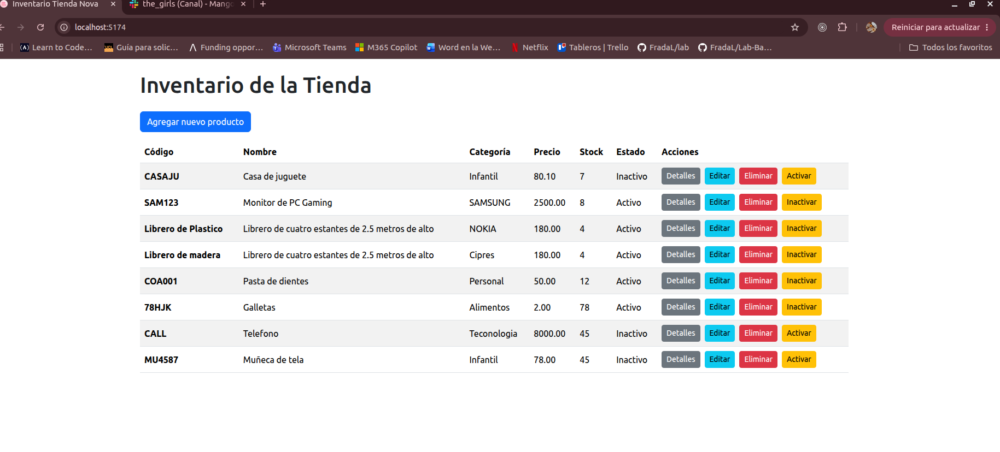

## Documentacion
1. Para los esquemas de zod: https://zod.dev/api
2. para las solicitudes con pool.query: https://node-postgres.com/features/queries
3. para informacion sobre cors: https://chatgpt.com/share/6acd50e4-acfc-83e8-98a8-4ee98bef5854
4. para el dise;o: https://getbootstrap.com/docs/6.0/getting-started/install/
                https://www.flaticon.es/

## Descripción del proyecto y tecnologías utilizadas.
Se utilizo base de datos sql (PostgreSQL)

## Requisitos y comandos para instalar las dependencias de ambos proyectos.

1. Ejecutar npm intall en fronted
2. Ejecutar npm install en backend

## Comandos para iniciar backend y frontend y sus direcciones locales.
1. Dependiendo de que quiera ejecutar, moverse a la carpeta (/backend o /fronted) y ejecutar npm run dev

## Listado de endpoints 
1. `[GET] /api/productos/ `
 para obtener todos los productos

2. `[GET] /api/productos/(id) `
para obtener un solo producto

3. `[PATCH] /api/productos/(id)/update`
para actualizar todos los datos de un producto

4. `[PUT] /api/productos/(id)`
para cambiar solo el estado de un producto

5. `[DELETE] /api/productos/(id)`  
para eliminar un producto

6. `[POST]/api/productos/`
para crear un nuevo producto

## Imagen
